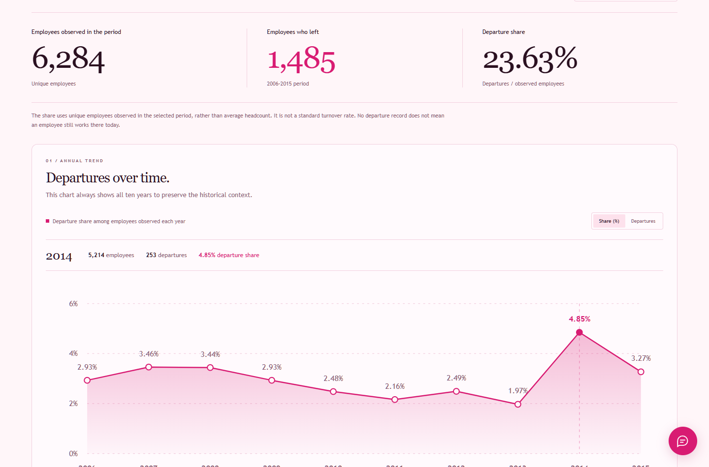
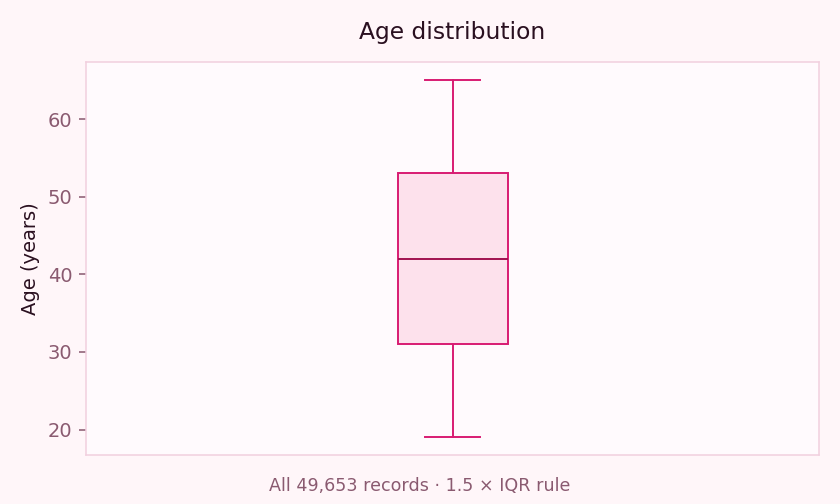
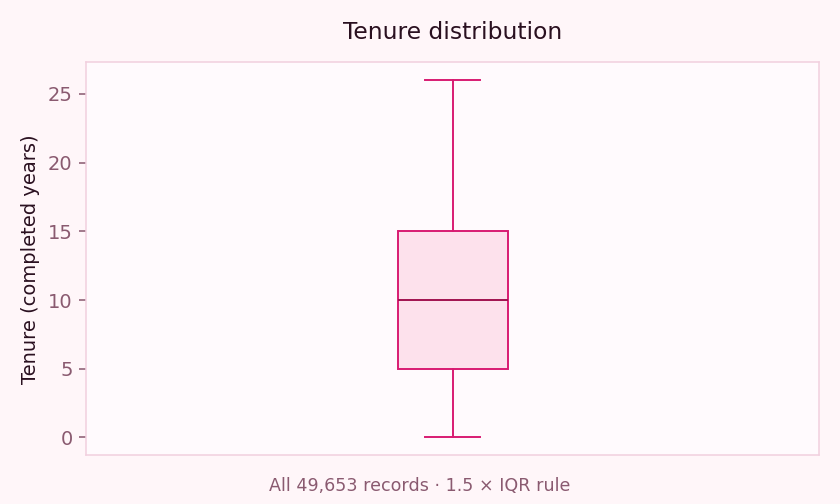
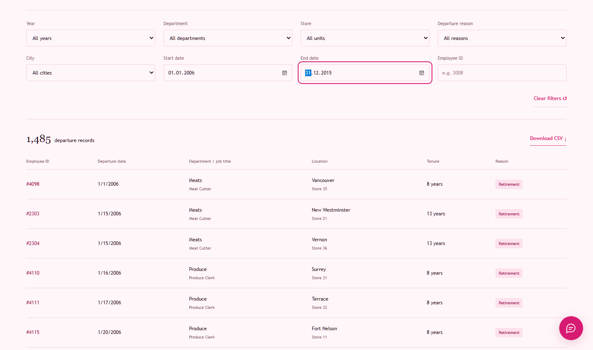
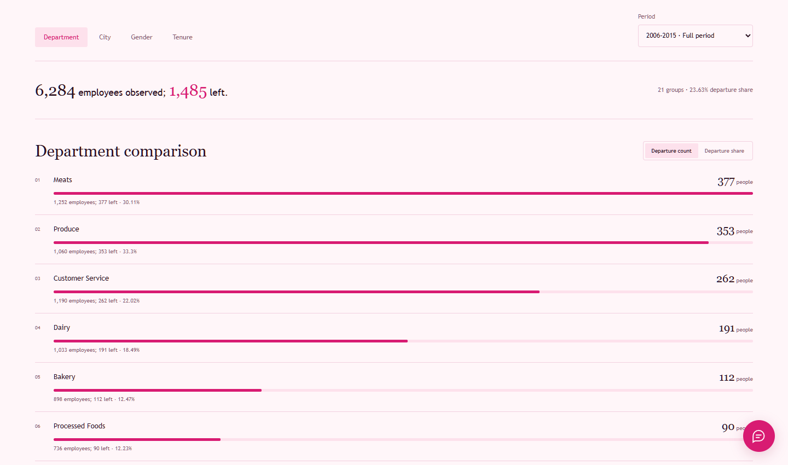
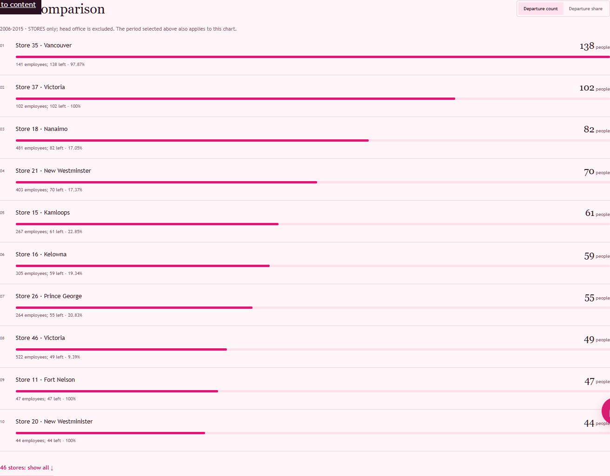
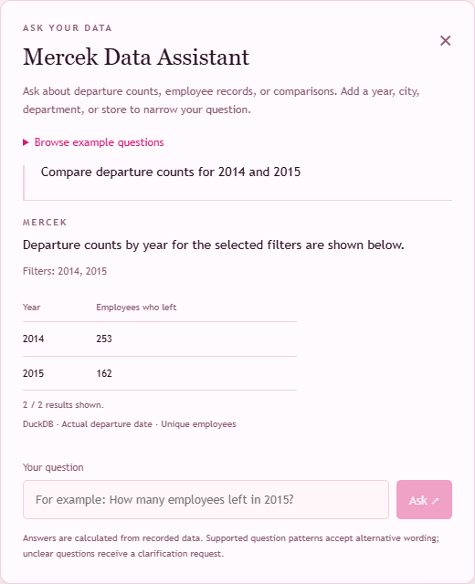
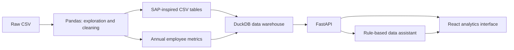

# Mercek — Employee Departure Analytics


**From raw employee records to a queryable data warehouse and an interactive analytics application.**

Mercek is a data analytics project I built to explore **when employees left, which departments and stores they belonged to, and the reasons recorded for their departures**. The project began with data exploration and cleaning, then grew into a complete workflow using SAP-inspired source tables, a DuckDB data warehouse, a FastAPI backend, and a React interface.

> The dataset is synthetic. The application analyzes historical records; it does not contain real employee information or predict future departures. The application has been tested locally with Docker Compose and has not been deployed to a public hosting service. The interface and data assistant are in English. Supported Turkish question patterns are retained for compatibility.



## Questions I explored

- How many records and unique employees does the dataset contain? What does a single row represent?
- How do departures vary by year, department, store, and recorded reason?
- How do age and length of service differ between resignation, retirement, and layoff groups?
- Does the absence of empty cells mean the data is complete?
- How should apparent duplicates, placeholder dates, and conflicting dates be handled?
- How can these findings become a web application with clearly defined calculations?

## Data source and record structure

**Dataset:** `MFG10YearTerminationData.csv`

**Source:** Lyndon Sundmark’s [AIHR — Employee Churn / People Analytics Using R](https://www.aihr.com/blog/tutorial-people-analytics-r-employee-churn/) tutorial. The [original dataset archive](https://www.aihr.com/wp-content/uploads/2016/09/Datasets-Tutorial-People-Analytics.zip) includes the CSV and an accompanying R Markdown document.

The source combines year-end snapshots of active employees with departures that occurred during each year. **A row is therefore not necessarily a different person:** the same employee may appear in multiple years, with changes in age, tenure, or organizational assignment. Departure events are taken from records where `STATUS = TERMINATED`.

| Dataset summary | Value |
| --- | ---: |
| Period covered | 2006–2015 |
| Raw records | 49,653 |
| Original columns | 18 |
| Unique employees | 6,284 |
| Departments | 21 |
| ACTIVE records | 48,168 |
| TERMINATED records / unique employees who left | 1,485 |
| Employees with no recorded departure during the period | 4,799 |

**The 4,799 employees cannot be assumed to still work there today.** They simply have no departure recorded within the dataset’s observation period. The dataset does not include employee names, salaries, overtime, satisfaction, or performance measures.

Download and source details are documented in [SOURCE.md](data/raw/SOURCE.md). The dataset’s licensing terms have not been independently verified; an open license is not assumed.

<details>
<summary><strong>Data dictionary: the 18 original columns</strong></summary>

| Column | Meaning |
| --- | --- |
| `EmployeeID` | Employee identifier; the same person may appear in multiple years |
| `recorddate_key` | Date represented by the record; not proof of when it was entered into a system |
| `birthdate_key` | Date of birth |
| `orighiredate_key` | Original hire date |
| `terminationdate_key` | Departure date; includes placeholder values in the raw data |
| `age` | Age at the time represented by the record |
| `length_of_service` | Length of service in completed years |
| `city_name` | City associated with the record; not assumed to be the employee’s home address |
| `department_name` | Department |
| `job_title` | Job title |
| `store_name` | Store or unit code, rather than a descriptive store name |
| `gender_short`, `gender_full` | Short and full gender labels |
| `termreason_desc` | Recorded reason for departure |
| `termtype_desc` | Voluntary or involuntary departure type |
| `STATUS_YEAR` | Year associated with the record |
| `STATUS` | ACTIVE or TERMINATED status for that year |
| `BUSINESS_UNIT` | STORES or HEADOFFICE classification |

</details>

## Key findings

### 1. Retirement accounts for the largest share of departures

| Recorded reason | Employees who left | Share of departures |
| --- | ---: | ---: |
| Retirement | 885 | 59.60% |
| Resignation | 385 | 25.93% |
| Layoff | 215 | 14.48% |
| **Total** | **1,485** | **100%** |

Individual percentages may not sum to exactly 100% because of rounding. In the source, retirement and resignation are classified as `Voluntary`, while layoffs are classified as `Involuntary`. There are 1,270 voluntary and 215 involuntary departures.

### 2. Departures peaked in 2014

| Year | Employees who left | Year | Employees who left |
| --- | ---: | --- | ---: |
| 2006 | 134 | 2011 | 110 |
| 2007 | 162 | 2012 | 130 |
| 2008 | 164 | 2013 | 105 |
| 2009 | 142 | **2014** | **253** |
| 2010 | 123 | 2015 | 162 |

Of the 253 departures in 2014, 142 were layoffs, 56 were retirements, and 55 were resignations. Layoffs appear in 2014 and 2015. This distribution alone does not establish the underlying company decisions or prove that a store closed.

### 3. Departure counts need to be considered alongside department size

| Department | Employees who left |
| --- | ---: |
| Meats | 377 |
| Produce | 353 |
| Customer Service | 262 |
| Dairy | 191 |
| Bakery | 112 |
| Processed Foods | 90 |

The first three departments account for 992 departures, approximately **66.80%** of the total. Larger teams may naturally have more departures, so the interface provides both counts and departure percentages relative to the number of employees observed. A 100% share in a small group means that every employee observed in that group has a departure record within the selected period; it is not a measure of current or future risk.

### 4. Resignation and retirement groups have different age and tenure profiles

| Departure reason | Average age | Average tenure (years) |
| --- | ---: | ---: |
| Layoff | 40.80 | 11.95 |
| Resignation | 30.10 | 4.64 |
| Retirement | 63.34 | 14.15 |

Among employees who resigned, 163 had completed either zero or one year of service: approximately **42.3%** of the 385 resignations. This does not measure the probability that a new employee will resign. That would require the full population at each tenure level and their observation periods.

Across all records, ages range from **19 to 65**, and tenure ranges from **0 to 26 years**. Age and tenure box plots showed no outliers under the standard 1.5 × IQR rule, so no records were removed on that basis. These summaries describe records, not a population with one observation per employee, because employees appear across multiple years.

<details>
<summary><strong>Age and tenure box plots from the analysis notebook</strong></summary>

| Age distribution | Tenure distribution |
| --- | --- |
|  |  |

</details>

### 5. A store code does not always identify a single business unit

Grouping `store_name = 35` without separating business units produces 207 employees who left. Applying the **STORES** filter reduces that number to **138**; the other 69 belong to head-office records. The difference comes from grouping two business units under the same code, rather than counting people twice.

The city analysis also identified two spellings: `New Westminster` and `New Westminister`. Both categories were retained because the dataset did not provide enough evidence to justify merging them.

Across the observation period, the departure share was 27.91% for female employees and 18.96% for male employees; the corresponding resignation shares were 6.44% and 5.79%. Much of the difference in departure counts appears in retirement records. These associations are not presented as evidence of causation or statistical significance.

## Data quality: what I changed and what I retained

The initial `isna()` check found no missing cells. That did not mean the dataset was complete or free of quality issues.

| Finding | Decision implemented |
| --- | --- |
| `1900-01-01` used as the departure date in 42,450 records | Treated as a placeholder, not a real departure date; converted to missing values in the cleaned file |
| Dates loaded as text | Converted four date columns during preparation; CSV exports store them as date strings |
| Misspelled `Resignaton` label | Corrected to `Resignation` in the cleaned file |
| Five additional employee–year records containing both ACTIVE and TERMINATED statuses | Retained both records rather than deleting them automatically |
| Two records dated before the employee’s hire date | Added `date_conflict_flag` without changing the original dates |
| `New Westminster` / `New Westminister` | Retained both spellings |
| `Not Applicable` in reason and type fields | Retained; not treated as evidence of current employment status |
| Later departure information present in earlier ACTIVE records | Counted departures only from actual TERMINATED events |

**The raw file was left unchanged.** The cleaned output contains **49,653 rows and 19 columns**, with the same **6,284 unique employees**. The additional column flags date conflicts.

The two flagged records are dated 9 and 26 days before the employees’ hire dates. All departure records have a record date on the first day of the month, suggesting a possible recording convention. The rows were retained rather than assumed to be erroneous. The distinction between `recorddate_key` and the actual departure date was preserved throughout the analysis.

## Application features

### Overview

A period filter, unique employee and departure counts, an annual area chart, stacked yearly departure reasons, a reason-distribution doughnut chart, and tenure at departure. The two time-series charts retain the full ten-year context, while the other summaries follow the selected period. Relevant charts link to the underlying departure records.

### Departure records

Filters for year, date range, department, store, city, and reason, along with employee-ID search, pagination, and CSV export. The export includes every record matching the filters and search, not just the current page.



### Comparisons

Compare departments, cities, genders, and tenure groups by departure count or percentage. **Store comparisons have their own permanently visible section.** Both sections use the same period filter. Store analysis includes only the STORES business unit.



<details>
<summary><strong>View the store comparison</strong></summary>



</details>

### Mercek Data Assistant — questions about the data

The pink icon in the bottom-right corner of every page opens the chat panel. The assistant queries DuckDB using predefined question types and filter-matching rules; it does not use a trained model or an external AI service. It recognizes alternative phrasings within its supported patterns, but it is not a general-purpose language model.

The assistant supports **English questions**, including alternative phrasings within its predefined query patterns. Examples:

- “How many employees left in 2014?”
- “Show store information for employees who left in 2014.”
- “List employees who resigned from the Meats department in 2015.”
- “Who left store 35?”
- “How many employees left between January and March 2014?”
- “Compare departure counts for 2014 and 2015.”
- “Show the top five departments by resignations.”
- “Show the departure record for employee 3008.”

Responses show the filters applied and the data source, with lists presented as tables. Head-office records are identified separately from stores. Unsupported or ambiguous questions prompt a clarification. The conversation is retained when switching pages but resets when the browser page is refreshed.



The interface follows the system’s light or dark theme preference. [Dark theme preview](docs/screenshots/pano-koyu.png).

## How the figures are calculated

- **Employee count:** distinct employee IDs. The number of rows is not the number of people.
- **Employees who left:** distinct employees in events where `STATUS = TERMINATED`, represented by `left_flag = 1` in the warehouse.
- **Departure share over a period:** unique employees who left / unique employees observed × 100. Across the full dataset, 1,485 / 6,284 ≈ **23.63%**.
- **Annual departure share:** unique employees who left in a year / unique employees observed in that year × 100. This is not a standard turnover rate calculated from average opening and closing headcount.
- **Reason percentages:** departures for a given reason / all departures in the selected period. The denominator is not the full employee population.
- **Group comparisons:** use each employee’s latest observation within the selected period. Where ACTIVE and TERMINATED records coexist in the same employee–year, the departure record takes precedence, assigning each person to one group.
- **Date filters:** use the actual `termination_date`, rather than the record date.

Some exploratory notebook calculations used “employees with any record in the group” as the denominator. The application uses the latest-observation approach instead. The two methods need not produce identical results, particularly for employees who changed groups.

## Architecture



| Layer | Tools and outputs |
| --- | --- |
| Exploration and visualization | Pandas, NumPy, Matplotlib, Seaborn, Jupyter |
| SAP-inspired preparation | PA0000 actions, PA0001 organizational assignments, PA0002 personal data |
| Data warehouse | DuckDB: raw tables, dimensions, and `fact_employee_year` |
| API | FastAPI with filtered, parameterized queries |
| Frontend | React, Vite, CSS, and SVG charts |
| Data assistant | Python question-type and filter matching with SQL reads |
| Validation | Comparisons against CSV results, unittest, and browser checks |

**There is no connection to a live SAP system.** The PA tables are educational CSV structures inspired by SAP field names. Time-varying attributes such as age and tenure are stored in annual metrics rather than forced into a static personal-data table. Because the five paired records were retained, employee × year is not a unique warehouse key; queries account for this.

<details>
<summary><strong>Project structure and suggested reading order</strong></summary>

```text
backend/                 FastAPI backend and data assistant
frontend/                React application
data/raw/                Original CSV and source documentation
data/processed/          Cleaned CSV, SAP-inspired tables, DuckDB warehouse
notebooks/
  01_analiz.ipynb         Exploration, data quality checks, and charts
  02_sap_hazirlama.ipynb  Preparation of SAP-inspired CSV tables
  03_duckdb_ambar.ipynb   Warehouse creation and SQL queries
docs/screenshots/        Application screenshots and analysis figures
tests/                   Data assistant tests
```

Start with [01_analiz](notebooks/01_analiz.ipynb), continue with [02_sap_hazirlama](notebooks/02_sap_hazirlama.ipynb), then review [03_duckdb_ambar](notebooks/03_duckdb_ambar.ipynb).

</details>

## Running locally

Install Python and Node.js/npm, download the project, and open a terminal in the repository root.

**1. Start the API:**

```powershell
python -m pip install -r backend/requirements.txt
python -m uvicorn backend.main:app --reload
```

**2. Start the frontend in a separate terminal:**

```powershell
cd frontend
npm ci
npm run dev
```

- Application: `http://localhost:5173`
- API: `http://127.0.0.1:8000`
- Interactive API documentation: `http://127.0.0.1:8000/docs`

Keep both terminals running. The prepared warehouse is located at `data/processed/warehouse.duckdb`. Vite forwards `/api` requests to the local backend. If you use a different API address, update both `VITE_API_URL` and the corresponding CORS configuration.

**To run the notebooks or rebuild the prepared data:**

```powershell
python -m pip install pandas numpy matplotlib seaborn duckdb notebook ipykernel
python -m notebook --notebook-dir=notebooks
```

The notebooks use `notebooks/` as their working directory; relative `../data/` paths are based on that location. CSV files do not preserve date types, so dates may need conversion when reloaded. The warehouse notebook’s `CREATE TABLE IF NOT EXISTS` statements do not refresh existing tables; rebuild the warehouse separately if the source data changes.

## Starting with Docker

With Docker Desktop running, execute this command from the repository root:

```powershell
docker compose up --build -d
```

Open the application at `http://localhost:8080` and the API documentation at `http://localhost:8080/docs`. The API and frontend run in separate containers, and the prepared synthetic DuckDB file is included in the backend image. You do not need to install Python or Node.js separately. To stop the application, run `docker compose down`.

For configuration details, installation steps, and checks, see the [Docker guide](docs/DOCKER.md), currently in Turkish. **Both images were built successfully, and container health, API results, and browser interactions were verified on October 18, 2026.**


This image presents actual `docker compose ps` output captured on October 18, 2026. [Plain-text output](docs/docker-durumu.txt). Run the same command in your terminal to check the current status.

## Validation

The data assistant tests also require Pandas:

```powershell
python -m pip install pandas
python -m unittest discover -s tests -v
```

Thirteen test cases cover English and Turkish question patterns, combined filters, date ranges, store versus head-office records, tenure boundaries, rankings, and unsupported questions. Expected results are calculated from the cleaned CSV.

To check CSV formula protection and text formatting:

```powershell
node --test frontend/src/csv.test.js
```

To build the frontend:

```powershell
cd frontend
npm run build
```

During development, API totals were compared against the CSV. Browser checks covered filters, links to records, CSV downloads, empty results, chat tables, conversation persistence across pages, mobile layouts, and light and dark themes.

## What I learned

- Define **what one row represents** before using the data.
- Distinguish missing cells from **placeholder values**, such as `1900-01-01`.
- **Investigate, flag, and document** questionable records before deciding whether to remove them.
- Keep **record counts, employee counts, and event counts** separate, and explain each percentage’s denominator.
- Avoid interpreting a large departure count as direct evidence of high departure risk.
- Preserve employee history while building source tables and a queryable **data warehouse**.
- Connect Python analysis to a **SQL → API → React** workflow.
- Validate results against source data and clearly communicate the data assistant’s limitations.

The project focuses on data analysis, data quality, and reporting. Its findings describe a synthetic dataset and should not be generalized directly to real companies.

A subsequent review corrected tenure boundaries, mixed date-format handling, and store totals in the assistant. CSV formula protection and request timeouts were added. Both Docker containers run as non-root users with read-only filesystems. Details are documented in the [review notes](docs/INCELEME_NOTLARI.md), currently in Turkish.
