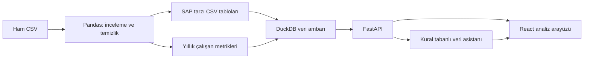

# Mercek — Çalışan Ayrılma Analizi


**Ham çalışan kayıtlarından, sorgulanabilir bir veri ambarına ve etkileşimli bir analiz uygulamasına.**

Mercek; çalışanların **ne zaman, hangi departmandan, hangi mağazadan ve hangi kayıtlı sebeple ayrıldığını** incelemek için geliştirdiğim bir veri analizi projesi. Çalışma, veriyi tanıma ve temizleme ile başladı; SAP tarzı kaynak tablolar, DuckDB veri ambarı, FastAPI ve React arayüzüyle tamamlandı.

> Veri seti sentetiktir. Uygulama geçmiş kayıtları inceler; gerçek çalışanlar hakkında bilgi veya geleceğe yönelik ayrılma tahmini sunmaz. Web uygulaması yerelde çalışır. Docker Compose ile yerel çalışma doğrulandı; canlı yayın henüz yapılmadı.


## Projede hangi soruları araştırdım?

- Veri setinde kaç kayıt ve kaç farklı çalışan var? Bir satır tam olarak neyi temsil ediyor?
- Ayrılmalar yıllara, departmanlara, mağazalara ve sebeplere göre nasıl dağılıyor?
- İstifa, emeklilik ve işten çıkarılma gruplarının yaş ve kıdemleri nasıl farklılaşıyor?
- Boş hücre olmaması gerçekten eksiksiz veri anlamına geliyor mu?
- Tekrar gibi görünen kayıtlar, işaret tarihler ve tarih çelişkileri nasıl ele alınmalı?
- Bu bulgular, hesap kuralları açık bir web uygulamasına nasıl aktarılabilir?

## Veri kaynağı ve kayıtların anlamı

**Veri seti:** `MFG10YearTerminationData.csv`

**Kaynak:** Lyndon Sundmark’ın [AIHR — Employee Churn / People Analytics Using R](https://www.aihr.com/blog/tutorial-people-analytics-r-employee-churn/) eğitimi. [Kaynak veri arşivi](https://www.aihr.com/wp-content/uploads/2016/09/Datasets-Tutorial-People-Analytics.zip) CSV ve R Markdown açıklamasını içerir.

Kaynak, her yılın sonunda aktif olan çalışanların kayıtlarını yıl içinde gerçekleşen ayrılmalarla bir araya getirir. Bu yüzden **her satır farklı bir kişi değildir**: aynı çalışanın farklı yıllarda yaşı, kıdemi ve organizasyon bilgileri değişebilir. Ayrılma olayları `STATUS = TERMINATED` kayıtlarından alınır.

| Veri özeti | Değer |
| --- | ---: |
| Dönem | 2006–2015 |
| Ham kayıt | 49.653 |
| Ham sütun | 18 |
| Benzersiz çalışan | 6.284 |
| Departman | 21 |
| ACTIVE kaydı | 48.168 |
| TERMINATED kaydı / benzersiz ayrılan çalışan | 1.485 |
| Dönemde ayrılma kaydı bulunmayan çalışan | 4.799 |

**4.799 kişi için bugün hâlâ çalışıyorlar denilemez.** Yalnızca veri döneminde ayrılma kayıtları yoktur. Çalışan isimleri, maaş, mesai, memnuniyet ve performans alanları veride bulunmaz.

İndirme ve kaynak ayrıntıları: [SOURCE.md](data/raw/SOURCE.md). Kaynak veri için ayrıca bir lisans doğrulaması yapılmadı; açık lisans varsayılmıyor.

<details>
<summary><strong>18 sütunun açıklaması</strong></summary>

| Sütun | Anlamı |
| --- | --- |
| `EmployeeID` | Çalışan kimliği; aynı kişi farklı yıllarda bulunabilir |
| `recorddate_key` | Kaydın temsil ettiği tarih; sisteme yazılma anını kanıtlamaz |
| `birthdate_key` | Doğum tarihi |
| `orighiredate_key` | İlk işe giriş tarihi |
| `terminationdate_key` | Ayrılma tarihi; ham veride işaret değerleri içerir |
| `age` | İlgili kayıttaki yaş |
| `length_of_service` | İlgili kayıttaki kıdem, tam yıl |
| `city_name` | Kayıttaki şehir; ikamet adresi olduğu varsayılmaz |
| `department_name` | Departman |
| `job_title` | İş unvanı |
| `store_name` | Mağaza/birim numarası; mağazanın açık adı değildir |
| `gender_short`, `gender_full` | Cinsiyetin kısa kodu ve açık yazımı |
| `termreason_desc` | Kayıtlı ayrılma sebebi |
| `termtype_desc` | Gönüllü / gönülsüz ayrılma türü |
| `STATUS_YEAR` | Kaydın ait olduğu yıl |
| `STATUS` | İlgili yıldaki ACTIVE / TERMINATED durumu |
| `BUSINESS_UNIT` | STORES / HEADOFFICE ayrımı |

</details>

## Analizden elde ettiğim sonuçlar

### 1. Ayrılma sebeplerinde emeklilik öne çıkıyor

| Kayıtlı sebep | Ayrılan çalışan | Ayrılanlar içindeki pay |
| --- | ---: | ---: |
| Emeklilik — Retirement | 885 | %59,60 |
| İstifa — Resignation | 385 | %25,93 |
| İşten çıkarılma — Layoff | 215 | %14,48 |
| **Toplam** | **1.485** | **%100** |

Yuvarlama nedeniyle kategori yüzdelerinin toplamı %100’den küçük bir fark gösterebilir. Emeklilik ve istifa kaynakta `Voluntary`, işten çıkarılma `Involuntary` olarak sınıflanır. Gönüllü ayrılma toplamı 1.270, gönülsüz ayrılma toplamı 215’tir.

### 2. En fazla ayrılma 2014’te gerçekleşmiş

| Yıl | Ayrılan çalışan | Yıl | Ayrılan çalışan |
| --- | ---: | --- | ---: |
| 2006 | 134 | 2011 | 110 |
| 2007 | 162 | 2012 | 130 |
| 2008 | 164 | 2013 | 105 |
| 2009 | 142 | **2014** | **253** |
| 2010 | 123 | 2015 | 162 |

2014’teki 253 ayrılmanın 142’si işten çıkarılma, 56’sı emeklilik ve 55’i istifadır. İşten çıkarılmalar veri setinde 2014 ve 2015 yıllarında görülür. Bu dağılım tek başına şirket kararı veya mağaza kapanışı hakkında kesin bir neden göstermez.

### 3. Departman büyüklüğü ile ayrılma sayısını ayrı değerlendirmek gerekiyor

| Departman | Ayrılan çalışan |
| --- | ---: |
| Meats | 377 |
| Produce | 353 |
| Customer Service | 262 |
| Dairy | 191 |
| Bakery | 112 |
| Processed Foods | 90 |

İlk üç departman 992 ayrılmayla toplamın yaklaşık **%66,80**’ini oluşturur. Büyük ekiplerde ayrılan kişi sayısı da yüksek olabilir; bu yüzden arayüzde kişi sayısı ile çalışan sayısına göre ayrılma payı ayrı sunulur. Bazı küçük gruplarda görülen %100, seçilen dönemde gözlenen çalışanların tamamında ayrılma kaydı bulunmasıdır; güncel veya gelecekteki risk değildir.

### 4. İstifa ve emeklilik gruplarının yaş ve kıdemleri farklı

| Ayrılma sebebi | Ortalama yaş | Ortalama kıdem (yıl) |
| --- | ---: | ---: |
| İşten çıkarılma | 40,80 | 11,95 |
| İstifa | 30,10 | 4,64 |
| Emeklilik | 63,34 | 14,15 |

İstifa edenlerin 163’ünde kıdem 0 veya 1 tam yıldır: 385 istifanın yaklaşık **%42,3**’ü. Bu sonuç, yeni çalışanların istifa olasılığını ölçmez; bunun için o kıdemlerdeki çalışanların tamamı ve gözlem süreleri gerekir.

Tüm kayıtlar üzerinde yaş aralığı **19–65**, kıdem aralığı **0–26 yıl**. Yaş ve kıdem kutu grafiklerinde standart 1,5 × IQR ölçütüne göre aykırı değer bulunmadı; bu gerekçeyle kayıt silinmedi. Aynı çalışan farklı yıllarda tekrarlandığından bu özetler benzersiz kişi ortalamaları değildir.

<details>
<summary><strong>Notebook’taki yaş ve kıdem kutu grafikleri</strong></summary>

| Yaş dağılımı | Kıdem dağılımı |
| --- | --- |
|  |  |

</details>

### 5. Aynı mağaza kodu her zaman aynı iş birimi demek değil

`store_name = 35` iş birimi ayrılmadan sayıldığında 207 ayrılan çalışan içeriyor. **STORES** filtresiyle sayı **138** oluyor; diğer 69 kişi merkez ofis kayıtlarında. Bu fark iki kez saymadan değil, farklı iş birimlerini aynı kod altında toplamaktan kaynaklanıyor.

Şehir analizinde `New Westminster` ve `New Westminister` yazımları bulundu. Bunları birleştirmek için yeterli veri kanıtı olmadığı için iki kategori korundu.

Cinsiyet analizinde kadınların dönemlik ayrılma payı %27,91, erkeklerin %18,96; istifa payları ise sırasıyla %6,44 ve %5,79 bulundu. Sayısal farkın büyük kısmı emeklilik kayıtlarında görülüyor. Bu ilişkiler nedensellik veya istatistiksel anlamlılık kanıtı olarak sunulmaz.


## Veri kalitesi: neleri değiştirdim, neleri korudum?

İlk `isna()` kontrolünde boş hücre çıkmadı. Ancak bu, verinin eksiksiz veya hatasız olduğu anlamına gelmiyordu.

| Bulgu | Uygulanan karar |
| --- | --- |
| 42.450 satırda `1900-01-01` ayrılma tarihi | Gerçek ayrılma tarihi olarak kullanılmadı; temiz dosyada boş değere çevrildi |
| Tarih sütunlarının metin olması | Dört tarih sütunu hazırlık sırasında tarihe çevrildi; CSV’de tarih metni olarak saklandı |
| `Resignaton` yazımı | Temiz dosyada `Resignation` olarak düzeltildi |
| Aynı çalışan ve yılda ACTIVE / TERMINATED bulunan 5 ek kayıt | İki kayıt da korundu; otomatik silinmedi |
| Kayıt tarihi işe girişten önce görünen 2 satır | Tarihler değiştirilmeden `date_conflict_flag` ile işaretlendi |
| `New Westminster` / `New Westminister` | Yazımlar birleştirilmedi |
| Sebep ve tür alanlarında `Not Applicable` | Korundu; doğrudan bugünkü aktiflik göstergesi sayılmadı |
| Geçmiş ACTIVE satırlarda sonraki ayrılma bilgileri | Ayrılma sayıları yalnızca gerçek TERMINATED olaylarından hesaplandı |

**Ham dosya değiştirilmedi.** Temiz çıktı **49.653 satır ve 19 sütun** içeriyor; çalışan sayısı yine **6.284**. Ek sütun tarih kontrol işaretidir.

İşaretlenen iki çalışanın kayıt tarihleri işe girişlerinden 9 ve 26 gün önce görünüyor. Bütün ayrılma kayıtlarının tarihinin ayın ilk günü olması bir kayıt kuralına işaret edebilir; kesin veri hatası varsayılıp satırlar silinmedi. `recorddate_key` ile gerçek ayrılma tarihinin farklı amaçları olduğu dikkate alındı.

## Uygulamada neler var?

### Nabız — genel durum

Dönem filtresi, benzersiz çalışan ve ayrılma sayıları, yıllık alan grafiği, yıllara göre ayrılma sebepleri, sebep dağılımı halkası ve ayrılma anındaki kıdem grafiği. İki zaman grafiği on yıllık bağlamı korurken diğer özetler seçilen döneme uyar. Grafiklerden ilgili ayrılma kayıtlarına geçilebilir.

### Veda defteri — kayıtların ayrıntısı

Yıl, tarih aralığı, departman, mağaza, şehir ve sebep filtreleri; çalışan numarasıyla arama, sayfalama ve filtreli CSV indirme. CSV yalnızca ekranda görünen sayfayı değil, filtrelere ve aramaya uyan bütün sonuçları içerir.


### Karşılaştırmalar — grupları birlikte değerlendirme

Departman, şehir, cinsiyet ve kıdem grupları kişi sayısı veya ayrılma payıyla karşılaştırılabilir. **Mağaza karşılaştırması ayrı ve sürekli görünen bir bölümde** yer alır. Her iki bölüm aynı dönem filtresini kullanır. Mağaza analizinde yalnızca STORES birimi bulunur.


### Mercek Veri Asistanı — kayıtlı verilere soru sorma

Her sayfada sağ alttaki pembe ikon sohbet panelini açar. Asistan, hazır soru türleri ve filtre eşleştirmeleriyle DuckDB verisini sorgular; model veya dış yapay zekâ servisi kullanmaz. Aynı sorunun farklı yazımlarını destekler, fakat her serbest cümleyi anlayan bir dil modeli değildir.

Örnek sorular:

- “2014 yılında kaç çalışan ayrıldı?”
- “2014’te ayrılanların mağaza bilgilerini getir.”
- “2015’te Meats departmanından istifa edenleri listele.”
- “35 numaralı mağazadan kimler ayrıldı?”
- “Ocak–Mart 2014 arasında kaç kişi ayrıldı?”
- “2014 ve 2015 ayrılma sayılarını karşılaştır.”
- “En çok istifa görülen beş departmanı göster.”
- “3008 numaralı çalışanın ayrılma bilgisi nedir?”

Cevaplarda uygulanan filtreler ve veri kaynağı görünür; listeler tablo olarak sunulur. Merkez ofis kayıtları mağaza diye etiketlenmez. Desteklenmeyen veya belirsiz sorularda açıklama istenir. Konuşma sayfalar arasında korunur; tarayıcı yenilenince sıfırlanır.


Açık/koyu tema sistem tercihine uyar. [Koyu tema görünümü](docs/screenshots/pano-koyu.png).

## Sayıları nasıl hesaplıyorum?

- **Çalışan sayısı:** benzersiz çalışan kimliği. Satır sayısı kişi sayısı değildir.
- **Ayrılan çalışan:** `STATUS = TERMINATED` / ambarda `left_flag = 1` olan olaylardaki benzersiz çalışan.
- **Dönemlik ayrılma payı:** ayrılan benzersiz çalışan / gözlenen benzersiz çalışan × 100. Tüm dönemde 1.485 / 6.284 ≈ **%23,63**.
- **Yıllık pay:** ilgili yılda ayrılan benzersiz çalışan / o yıl gözlenen benzersiz çalışan × 100. Ortalama yıl başı/sonu personelle hesaplanan standart devir oranı değildir.
- **Sebep yüzdeleri:** ilgili sebeple ayrılanlar / seçilen dönemde ayrılanlar. Payda bütün çalışanlar değildir.
- **Grup karşılaştırması:** her çalışanın seçilen dönemdeki son gözlemi kullanılır. Aynı çalışan-yıldaki eşleşmede ayrılma kaydı önceliklidir. Böylece kişi gruplara bir kez atanır.
- **Tarih filtreleri:** gerçek `termination_date` üzerinden uygulanır; kayıt tarihiyle karıştırılmaz.

Keşif notebook’unda bazı grup paydaları “o grupta herhangi bir kaydı olan çalışanlar” üzerinden incelenmiştir. Uygulamanın son gözlem yaklaşımı farklıdır; özellikle grup değiştiren çalışanlarda iki yöntemin sonuçları aynı olmak zorunda değildir.

## Teknik yapı



| Katman | Kullanılan araç / çıktı |
| --- | --- |
| İnceleme ve görselleştirme | Pandas, NumPy, Matplotlib, Seaborn, Jupyter |
| SAP tarzı hazırlık | PA0000 aksiyonlar, PA0001 organizasyon, PA0002 kişisel bilgiler |
| Veri ambarı | DuckDB; ham tablolar, boyutlar ve `fact_employee_year` |
| API | FastAPI; filtreli ve parametreli sorgular |
| Arayüz | React, Vite, CSS ve SVG grafikler |
| Veri asistanı | Python; soru türü / filtre eşleştirmesi, SQL ile okuma |
| Kontroller | CSV ile sonuç karşılaştırmaları, unittest, tarayıcı kontrolleri |

**Gerçek SAP sistemine bağlanılmadı.** PA tabloları, SAP alan adlarından esinlenen eğitim amaçlı CSV yapılarıdır. Yaş ve kıdem gibi zamanla değişen alanlar kişisel ana veri tablosuna sıkıştırılmadı; yıllık metriklerde tutuldu. Ambarda korunan beş çift kayıt nedeniyle çalışan × yıl tek başına benzersiz anahtar değildir; sorgularda bu durum dikkate alınır.

<details>
<summary><strong>Proje dosyaları ve inceleme sırası</strong></summary>

```text
backend/                 FastAPI ve veri asistanı
frontend/                React uygulaması
data/raw/                Ham CSV ve kaynak açıklaması
data/processed/          Temiz CSV, SAP tarzı tablolar, DuckDB ambarı
notebooks/
  01_analiz.ipynb         Veri inceleme, kalite kontrolleri ve grafikler
  02_sap_hazirlama.ipynb  SAP tarzı CSV tablolarını hazırlama
  03_duckdb_ambar.ipynb   Veri ambarını oluşturma ve SQL sorguları
docs/screenshots/        Uygulama ve analiz görselleri
tests/                   Veri asistanı kontrolleri
```

Önce [01_analiz](notebooks/01_analiz.ipynb), sonra [02_sap_hazirlama](notebooks/02_sap_hazirlama.ipynb), ardından [03_duckdb_ambar](notebooks/03_duckdb_ambar.ipynb) incelenebilir.

</details>

## Yerelde çalıştırma

Python ve Node.js/npm kurulmuş olmalıdır. Önce projeyi indirip ana klasöründe bir terminal aç.

**1. API’yi başlat:**

```powershell
python -m pip install -r backend/requirements.txt
python -m uvicorn backend.main:app --reload
```

**2. Ayrı bir terminalde arayüzü başlat:**

```powershell
cd frontend
npm ci
npm run dev
```

- Uygulama: `http://localhost:5173`
- API: `http://127.0.0.1:8000`
- Etkileşimli API dokümanı: `http://127.0.0.1:8000/docs`

İki terminal de açık kalmalıdır. Hazırlanmış ambar `data/processed/warehouse.duckdb` içindedir. Vite, `/api` isteklerini yerel API’ye iletir. Farklı API adresi kullanılacaksa `VITE_API_URL` ve ilgili CORS ayarları birlikte düzenlenmelidir.

**Notebook’ları çalıştırmak veya veriyi yeniden hazırlamak için:**

```powershell
python -m pip install pandas numpy matplotlib seaborn duckdb notebook ipykernel
python -m notebook --notebook-dir=notebooks
```

Notebook’lar `notebooks/` çalışma klasörünü kullanır; `../data/` yolları buna göredir. CSV dosyaları tarih veri tipini saklamaz; yeniden okunduğunda tarih dönüşümü gerekebilir. Ambar notebook’undaki `CREATE TABLE IF NOT EXISTS` mevcut tabloları yenilemez; kaynak değişirse ambarın ayrıca yeniden oluşturulması gerekir.

## Docker ile tek komutta başlatma

Docker Desktop açıkken proje ana klasöründe:

```powershell
docker compose up --build -d
```

Site `http://localhost:8080`, API dokümanı `http://localhost:8080/docs` adresindedir. API ve arayüz ayrı konteynerlerde çalışır; hazır sentetik DuckDB dosyası API imajına eklenir. Python veya Node.js’i ayrıca kurmak gerekmez. Kapatmak için `docker compose down` kullanılır.

Dosyaların görevleri, kurulum ve kontroller: [Docker rehberi](docs/DOCKER.md). **Docker imajları oluşturuldu; iki servisin sağlığı, API sonuçları ve tarayıcı akışı doğrulandı (18 Ekim 2026).**


Görsel, 18 Ekim 2026’da alınan gerçek `docker compose ps` çıktısının sunumudur. [Metin çıktısı](docs/docker-durumu.txt). Canlı durumu görmek için aynı komutu kendi terminalinde çalıştırabilirsin.

## Doğrulama

Veri asistanı testleri için Pandas’ın da kurulu olması gerekir:

```powershell
python -m pip install pandas
python -m unittest discover -s tests -v
```

On bir test grubu; farklı soru yazımlarını, birleşik filtreleri, tarih aralıklarını, mağaza–merkez ofis ayrımını, kıdemi, sıralamaları ve desteklenmeyen soruları kontrol eder. Beklenen sonuçlar temiz CSV’den hesaplanır.

CSV çıktısında formül güvenliği ve metin biçimlendirme kontrolleri:

```powershell
node --test frontend/src/csv.test.js
```

Arayüz derlemesi:

```powershell
cd frontend
npm run build
```

Geliştirme sırasında API toplamları CSV ile karşılaştırıldı; filtreler, kayıt bağlantıları, CSV indirme, boş sonuçlar, sohbet tabloları, konuşmanın sayfalar arasında korunması, mobil görünüm ve açık/koyu tema tarayıcıda kontrol edildi.

## Bu projede öğrendiklerim

- Veriyi kullanmadan önce **bir satırın neyi temsil ettiğini** tanımlamak.
- Boş hücre ile `1900-01-01` gibi **işaret değerini** ayırmak.
- Şüpheli kaydı hemen silmek yerine **incelemek, işaretlemek ve kararını belgelemek**.
- **Kayıt, kişi ve olay sayısını** karıştırmamak; bir oranın paydasını açıklamak.
- Çok sayıda ayrılma görülen grubu, doğrudan yüksek riskli grup diye yorumlamamak.
- Çalışan geçmişini koruyarak kaynak tabloları ve sorgulanabilir bir **veri ambarı** kurmak.
- Python analizlerini **SQL → API → React** akışına taşımak.
- Sonuçları kaynak veriye karşı kontrol etmek ve soru asistanının sınırlarını açıkça belirtmek.

Projenin odağı veri analizi, veri kalitesi ve raporlamadır. Bulgular sentetik veri setine aittir; gerçek şirketlere doğrudan genellenmez.


Son incelemede asistanın ilk yıl/kıdem sınırları, karışık tarih biçimleri ve mağaza toplamı düzeltildi. CSV formül koruması ve istek zaman aşımı eklendi. Docker konteynerleri yönetici olmayan kullanıcılarla, salt okunur dosya sistemiyle çalışır. Ayrıntılar: [İnceleme notları](docs/INCELEME_NOTLARI.md).
